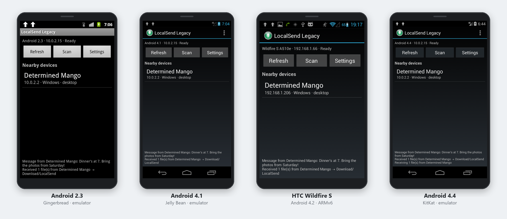
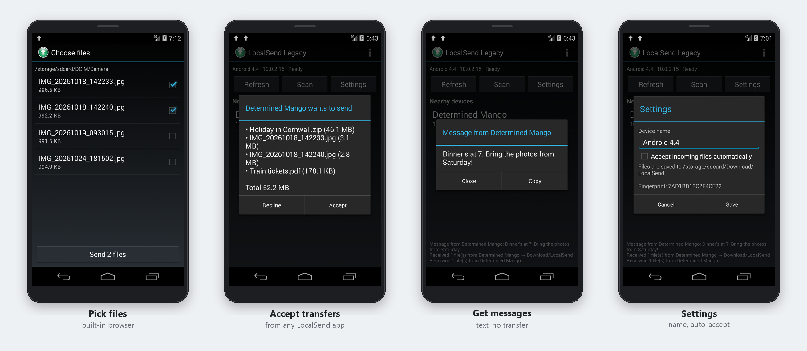
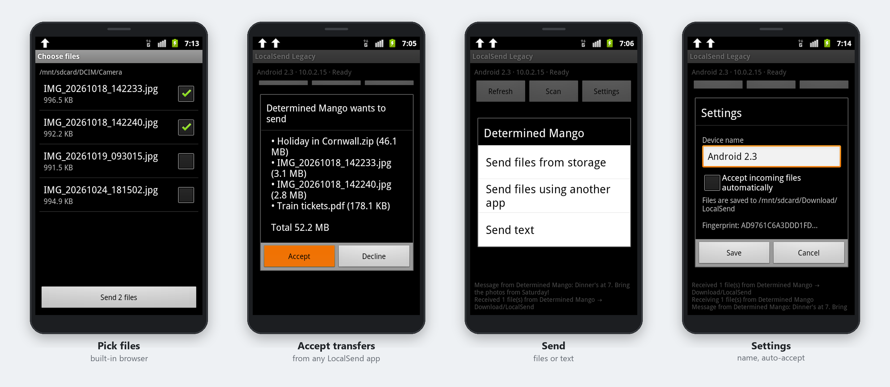

<p align="center">
  
</p>

<h1 align="center">LocalSend Legacy</h1>

<p align="center">
  <a href="https://github.com/mdukasa/localsend-legacy/releases/latest">Download the APK</a> ·
  Android 2.3 – 4.4 · any CPU
</p>

A LocalSend-compatible file sharing app for old Android phones and tablets that the official app can't
run on: anything from Android 2.3 to 4.4, whatever the CPU. That includes ARMv6 phones like the HTC
Wildfire S, Galaxy Mini and Optimus One, as well as ARMv7, x86 (e.g. Atom-based Motorola and Asus
devices) and MIPS ones.

The official LocalSend is built with Flutter, which needs ARMv7+ and Android 5.0+. This app isn't a
recompile of that codebase. It's a small native Java app that speaks the same
[LocalSend protocol v2](https://github.com/localsend/protocol), so it shows up in, and can send to and
receive from, current LocalSend apps on Windows, macOS, Linux, Android and iOS. It has no native code,
so one APK runs on every CPU architecture.



## Screenshots

On Android 4.4 (KitKat), with the Holo theme:



On Android 2.3 (Gingerbread):



## Compatibility

| Android | Status |
|---|---|
| 2.3 – 2.3.7 (API 9–10) | Supported. Tested on the 2.3.7 x86 emulator: send file, send text, receive |
| 3.x (API 11–13) | Should work; untested |
| 4.0 – 4.3 (API 14–18) | Supported. Tested on an HTC Wildfire S (ARMv6, CM 10.1 / 4.2.2) |
| 4.4 (API 19) | Supported. Tested on the 4.4.2 x86 emulator: send text, receive |
| 5.0+ | Works, but you probably want the [official app](https://localsend.org) |

Specific fixes for old Android versions:
- Android 2.x ships its own, older BouncyCastle library. The app's copy is renamed at build time so the two can't collide.
- Android 4.3 and older can seed `SecureRandom` badly, so the app reads `/dev/urandom` directly for its keys and transfer tokens.
- Many 2.x phones have no app that can pick arbitrary files, so there's a built-in file browser ("Send files from storage").
- Devices on Ethernet or USB tethering (TV boxes, some tablets) work too. The app falls back to those networks when there's no Wi-Fi.

## Features

- Discovery via multicast (224.0.0.167:53317), plus an HTTP subnet **Scan** for networks that drop multicast
- Receive files, with an accept/decline prompt or auto-accept. Files go to `Download/LocalSend/`
- Receive text messages
- Send files from the built-in file browser, another app's picker, or any app's **Share** menu, and send text
- Runs in the background as a foreground service, with progress notifications

## How it works on old Android

| Problem | What this app does |
|---|---|
| Flutter needs ARMv7 and API 21+ | Plain Java/Dalvik with minSdk 9 and no native libraries |
| LocalSend's HTTPS server only offers AES-GCM / TLS 1.2+, which Android 4.x doesn't have | Bundles BouncyCastle's pure-Java TLS 1.2/1.3 for outgoing connections and prefers ChaCha20, which is faster without AES hardware |
| LocalSend 1.18+ requires a TLS **client certificate** | Generates a self-signed ECDSA P-256 identity on first launch. Its SHA-256 is our fingerprint |
| Serving TLS from a 600 MHz phone is slow | Announces `"protocol": "http"`, so peers send to us over plain HTTP |

When we send to an HTTPS peer whose fingerprint we already know, its server certificate is pinned to
that fingerprint.

Not implemented yet: PIN-protected receivers, the browser "share via link" download API, and an HTTPS
server mode.

## Build

Requires JDK 17 and the Android SDK (platform 34, build-tools 34).

```
./gradlew assembleRelease
```

The APK is written to `app/build/outputs/apk/release/app-release.apk`. Release builds are signed with
the debug key and shrunk with R8. Without R8, BouncyCastle goes over the 64K-method dex limit.

## License

Apache-2.0, the same license as LocalSend. This is an unofficial project, not affiliated with the
LocalSend team.
